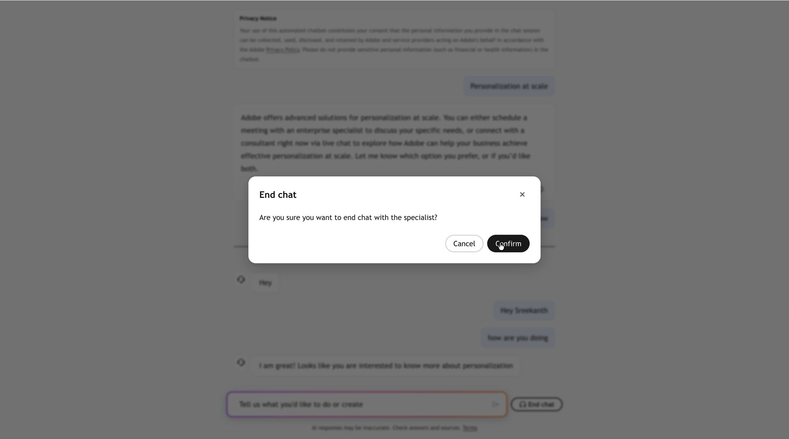

# ライブチャットとミーティングの予約の概要 {#overview}

コンシェルジュは、ほとんどの質問に自分で答えます。 価格の交渉、調達アンケート、デモの依頼など、いくつかの会話には人が必要です。 ライブチャットとミーティングの予約は、Adobe Brand Conciergeが訪問者の提供したコンテキストを失うことなく、会話を人間に引き継ぐ2つの方法です。

* ライブチャットは、同じチャットウィンドウで、訪問者をすぐに利用可能な担当者に接続します。
* ミーティング予約は、訪問者に担当者のカレンダーから実際のオープンスロットを提供し、ミーティングを予約します。

どちらも同じスキルで提供され、**[!UICONTROL セールスへの引き継ぎ]**、および両方のルートで[!DNL Adobe Marketo Qualifier] （旧[!DNL Sales Qualifier]）を経由します。担当者はカレンダーを接続し、空き時間を設定し、チャットを利用します。

## ハンドオフの仕組み {#how-it-works}

訪問者が人間の目の前に並ぶには、4つのピースが必要です。

| 部分 | 各ボタンの機能 | ワークスペースを定義し |
| --- | --- | --- |
| 代表者プロファイル | カレンダーを接続し、担当者がミーティングやチャットに利用できる日時を宣言します | [!DNL Adobe Marketo Qualifier] > **[!UICONTROL プロファイル設定]** |
| ルーティング | この訪問者を取得する&#x200B;*担当者*&#x200B;を決定します | [!DNL Adobe Marketo Qualifier] > **[!UICONTROL ルーティングルール]**、および各統合のルーティングタイプ |
| 統合 | **[!UICONTROL ミーティング予約]**&#x200B;および&#x200B;**[!UICONTROL ライブチャット]**&#x200B;により、コンシェルジュは空き状況の確認、チャットの開始、スロットの予約を行うことができます | Composer > **[!UICONTROL 統合を参照]** |
| スキル | **[!UICONTROL 営業担当者への引き継ぎ]**&#x200B;は、訪問者の意図に基づいて、*が引き継ぎを提供する* タイミングを決定します | コンポーザー> **[!UICONTROL スキルを参照]** |

実行時に、訪問者はスキルの&#x200B;**[!UICONTROL 使用時]**&#x200B;条件のいずれかに一致するメッセージを表示します。 どの統合が接続されていても、スキルが起動し、呼び出しが行われます。 その後、ルーティングによって担当者が解決され、訪問者にはチャット、ミーティング、またはその両方が提供されます。

>[!NOTE]
>
>スキルと統合は、コンシェルジュの一般的な構成要素です。 基になるモデルについては、[ スキルと統合フレームワーク ](../skills-and-integrations.md)を参照してください。

## 訪問者の体験 {#visitor-experience}

スキルが起動すると、コンシェルジュはオプションを説明し、会話のボタンとして提示します。

{width="800" zoomable="yes"}

### ライブチャット {#visitor-live-chat}

訪問者がチャットを選択した場合、ルーティングにより利用可能な担当者が見つかる間、コンシェルジュは接続状態を表示します。

{width="800" zoomable="yes"}

代表者が参加する前に、訪問者は短い事前チャットフォームに入力します。 これらの回答は会話と一緒に移動し、チャットの受信トレイに&#x200B;**[!UICONTROL フォームの詳細]**&#x200B;として担当者に表示されるので、訪問者は何も繰り返す必要はありません。

訪問者はいつでもチャットを終了でき、確認を求められます。

{width="800" zoomable="yes"}

### ミーティング予約 {#visitor-meeting-booking}

訪問者がミーティングの予約を選択した場合、コンシェルジュは、ルーティングされた担当者のカレンダーに表示されているスロットを、訪問者自身のタイムゾーンで表示します。

{width="800" zoomable="yes"}

訪問者がスロットを確認すると、訪問者は担当者の確認メールを受信します。このメールには、オプションで[!DNL Microsoft Teams] リンクが含まれます。 会話のコンテキストは、招待状を持つ代表者に送られます。

## 始める前に必要なもの {#prerequisites}

* [!DNL Adobe Marketo Qualifier]へのアクセス。担当者が[!DNL Adobe Admin Console]のユーザーとして追加されました。
* カレンダーに接続している担当者が少なくとも1人います。 **[!UICONTROL 会議の予約]**&#x200B;統合をアクティブ化するには、次の操作を行う必要があります。
* ライブチャットの可用性を設定している担当者が少なくとも1人います。 **[!UICONTROL ライブチャット]**&#x200B;統合は、アクティブ化されるまでアクティブ化できません。
* 統合やスキルを追加できるComposerのコンシェルジュ。

>[!NOTE]
>
>ライブチャットとミーティングの予約には[!DNL Adobe Marketo Engage]は必要ありません。 itを使用しない場合、代表者、会議、チャットのデータは[!DNL Adobe Marketo Qualifier]に残ります。 [!DNL Marketo Engage]が必要なのは2つあります。[!DNL Marketo]のリードおよび企業属性に基づいて構築されたカスタムルーティングルールと、[!DNL Marketo]人の個人レコードに書き戻されるコンシェルジュアクティビティタイプです。

## ライブチャットとミーティング予約の設定 {#setup-path}

順を追って進めていきます。

1. [Adobe Marketo Qualifierで担当者を設定](representative-setup.md) — カレンダーを接続し、確認メールを定義し、カレンダーとライブチャットの空き状況を設定します。
1. [会話を担当者にルーティング ](routing-rules.md) — [!DNL Marketo]属性に基づいて作成されたラウンドロビン、ダイレクトエージェント、またはカスタムルールを選択します。
1. [ ライブチャットとミーティング予約を有効にする](configure-in-composer.md) — 2つの統合を接続し、**[!UICONTROL セールスへの引き継ぎ]** スキルを有効にします。
1. [ チャット受信箱](chat-inbox.md) – 会話のスコアリングなど、担当者がチャットを受信したら実行すること。
1. [Marketo EngageのBrand Concierge データ ](marketo-activities.md) — [!DNL Marketo]に書き戻されたリードフィールドとアクティビティタイプ、およびスマートキャンペーンでの使用方法。
1. [会議とライブチャットを監視](monitor.md) – 予約リストとパフォーマンスダッシュボード。

## データ保持 {#retention}

ライブチャットの会話は30日間保持されます。
