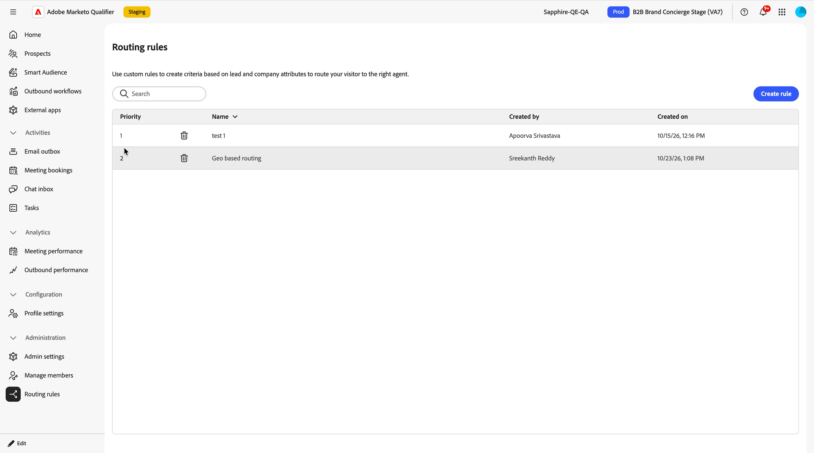

# 代表者への会話のルーティング {#routing}

ルーティングは、1つの質問に答えます。この訪問者がユーザーを求めると、*どの*&#x200B;人を取得しますか？

**[!UICONTROL ミーティング予約]**&#x200B;統合と&#x200B;**[!UICONTROL ライブチャット]**&#x200B;統合のルーティングタイプを個別に選択します。これにより、コンシェルジュは、すべてのチャットを1人のスペシャリストに送信したり、他の組み合わせに送信したりしながら、ミーティングを均等に配分できます。

## ルーティングタイプ {#routing-types}

| ルーティングタイプ | 適切な担当者を設定します | [!DNL Marketo Engage]が必要です |
| --- | --- | --- |
| **[!UICONTROL ラウンドロビン]** | 対象者全員に配布 | × |
| **[!UICONTROL ダイレクトエージェント]** | One representative you name | × |
| **[!UICONTROL カスタムルーティング]** | 訪問者が選定する最優先度のルーティングルールに割り当てられた担当者 | はい |

ラウンドロビンはデフォルトで使用でき、設定は必要ありません。 統合自体でルーティングタイプを設定します。 [ ライブチャットとミーティング予約の有効化](configure-in-composer.md)を参照してください。

### ラウンドロビン {#round-robin}

ラウンドロビンの動作は、チャットの場合とは異なります。これは、2つの目標が異なるためです。

**会議の予約**&#x200B;に対して、ラウンドロビンは会議を均等に配分します。 最初にカレンダーを接続した資格のある担当者が最初に提供されます。 ミーティングの予約が完了すると、ミーティングはプールから削除され、次の代表者が提案されます。 5人の代表者が参加し、最初の5つの会議は5人の関係者で行われます。 全員が1つを受け取った後、プールがリセットされ、サイクルが再び開始されます。

また、プールは24時間ごとにリセットされるので、毎日のミーティングは均等に配分されます。

>[!NOTE]
>
>24時間のラウンドロビンリセットは、担当者のローカルタイムゾーンではなく、UTCで実行されます。

**ライブチャット**&#x200B;の場合、順次ローテーションはありません。 資格のある担当者には、同時にチャットの着信が通知され、最初の担当者が会話を受け入れます。

### ダイレクトエージェント {#direct-agent}

このコンシェルジュサービスのミーティングやチャットは、すべて選択した担当者が担当します。 これは、1人のアカウントエグゼクティブが所有するキャンペーンランディングページや、1人のスペシャリストがいる地域で使用できます。

### カスタムルーティング {#custom-routing}

カスタムルーティングでは、訪問者の[!DNL Marketo]のリードおよび企業属性に対して[!DNL Adobe Marketo Qualifier]で構築したルールが評価されます。 適切な担当者が、次のような訪問者について把握している情報に依存する場合に使用します。

* **地域** – 国のグループの訪問者が地域チームにアクセスします。
* **製品への関心** – 特定の製品に興味を持つ訪問者は、その製品の専門家にアクセスします。
* **事業部、企業規模、業界** — リード属性と企業属性の任意の組み合わせ。

>[!IMPORTANT]
>
>カスタムルーティングは、[!DNL Adobe Marketo Engage]が必要なライブチャットおよびミーティング予約の一部です。ルールは[!DNL Marketo]個のリードおよび企業属性に基づいて構築されているためです。 ラウンドロビンとダイレクトエージェントはit部門の力を借りずに動作します。

## カスタムのルーティングルールの作成 {#create-rule}

1. [!DNL Adobe Marketo Qualifier]で、**[!UICONTROL 管理]**&#x200B;の下の「**[!UICONTROL ルーティングルール]**」を選択します。

   このリストには、組織内のすべてのルールとその優先度、名前、作成者、作成日が表示されます。

   {width="800" zoomable="yes"}

1. 「**[!UICONTROL ルールを作成]**」を選択し、ルールに名前を付けます。

1. 基準の構築：

   左側のパネルには、**[!UICONTROL 会社]**&#x200B;および&#x200B;**[!UICONTROL リード]** （人物）オブジェクトから使用可能な[!DNL Marketo]属性が一覧表示されます。 属性を検索し、キャンバスにドラッグして条件を追加します。

1. 各条件に演算子と値を設定します。

   演算子には、**[!UICONTROL equals]**、**[!UICONTROL 次と等しくない]**、**[!UICONTROL contains]**&#x200B;などがあります。 例えば、`Country` **[!UICONTROL は]** `United States`と等しくなります。

1. 条件をグループに組み合わせる。

   1つのグループに複数の条件を追加し、**[!UICONTROL AND]**&#x200B;または&#x200B;**[!UICONTROL OR]**&#x200B;と結合します。 さらにグループを追加し、**[!UICONTROL AND]**&#x200B;または&#x200B;**[!UICONTROL OR]**&#x200B;のグループにも参加します。 この方法でグループ内に条件をネストすると、*（国は米国またはカナダ）や（製品の関心にはAnalyticsが含まれる）*&#x200B;などの複雑な条件を表現できます。

1. ルールを代表者に割り当てます。

   「割り当て」セクションで、担当者を名前で検索し、リストから選択します。 好きなだけ代表者を追加します。 ルールに一致する会話を受け取ることができます。

1. 「**[!UICONTROL 保存]**」を選択します。

## 優先度の適用方法 {#priority}

すべてのルーティングルールに優先順位があります。 優先度は、訪問者が複数のルールに適格である場合にのみ重要です。

その場合、最優先一致ルールのみが適用され、会話はそのルールに割り当てられた担当者にルーティングされます。 訪問者も適格ですが、ランクが低いルールは無視されます。

>[!NOTE]
>
>低い数値は、より高い優先度を意味します。 優先度1のルールは、優先度2のルールよりも優先されます。 ルールを作成するユーザーが優先度を設定します。

勝者ルール内では、それに割り当てられた代表者が対象プールとなり、上記のラウンドロビンとオールエージェントの動作がそのプールに適用されます。

## 次の手順 {#next}

代表者を設定し、ルーティングを決定したら、コンシェルジュに機能を追加します。 [ ライブチャットとミーティング予約の有効化](configure-in-composer.md)を参照してください。
